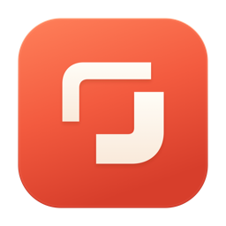

<p></p>

# Pilothouse

**工作在远处，掌控在手边。**
*Remote coding agents, native on Mac. Work anywhere. Stay at the helm.*

Pilothouse 让 coding agent 常驻在你的工作机上持续干活，你在 Mac 上用一个原生界面掌控它们。代码仓库和运行环境既可以放在工作机上，也可以就留在你的 Mac 上。多台机器、多个项目、多个会话都在一处；合上电脑、换网络、断线都不影响 Agent，回来打开就接着看。

[**下载最新版本 →**](https://github.com/davidxuxuxu/pilothouse-releases/releases)

> 目前是测试版，界面只有中文。

## 为什么用 Pilothouse

- **原生交互，不等网络。** 输入、滚动、渲染都在本地完成。网络慢（几百毫秒延迟）或者断开时界面也不卡，重连后自动补齐。
- **Agent 在远处，代码在手边。** 只有 Agent 跑在工作机上；项目可以就放在你的 Mac 上。Agent 读写文件、跑命令、构建和测试，都发生在这台 Mac 的项目目录里，用的是你本地的工具链、依赖、模拟器和运行环境。代码不用同步到服务器，也不用在工作机上再配一遍环境；审阅、diff、撤销照常可用。
- **合上电脑，Agent 继续。** Agent 跑在工作机上，客户端关掉、休眠都不打断它。回来时从离开的地方接着看。
- **机器、项目、会话，一处掌控。** 侧栏按机器和项目分组，⌘K 搜索所有会话。

## 功能

- **本地项目**：建项目时「源文件夹」选「此电脑」，文件和命令就在这台 Mac 上执行，Agent 仍在工作机上思考。同一套界面、同一套审阅和撤销；危险命令（如 `git push --force`、`git reset --hard`）要你确认后才执行。工作机上的项目也一样支持，两种可以混用。本地项目要这台 Mac 开着才能干活；想合上电脑让 Agent 接着做，就把项目放在工作机上。
- **一键添加工作机**：填一个 SSH 地址，Pilothouse 自动检查机器、装好所需的一切、注册开机自启并完成配对。工作机可以是另一台 Mac、一台 Linux 服务器，也可以就是这台 Mac。
- **快而稳的连接**：优先 QUIC，自动降级到 TLS，再到 SSH；全程加密，证书固定。
- **对话**：Markdown、代码块、表格、图片，工具调用折叠，回合刻度尺；回滚到任意一条消息、分叉会话、旁路提问、压缩上下文。
- **输入**：Agent 运行中可以排队或插话，Esc 停止；粘贴图片和文件；斜杠命令和技能补全；语音输入（⌘D）；每个会话单独保存草稿。
- **模型与账号**：直接登录 Claude、ChatGPT 等订阅，或使用 API Key；随时切换模型和思考强度，查看订阅额度。
- **审阅改动**：每个回合改了哪些文件、diff、一键撤销；在 diff 上加批注，引用到下一条消息里。
- **Agent 协作**：会话之间可以互相发消息、开子会话。
- **通知与定时任务**：工作机上的脚本和 CI 可以推送通知到 Mac，也可以直接交给 Agent 处理；自带定时任务。
- **让 AI 操作你的 Mac**（可选）：经你授权后，Agent 可以看屏幕、点击和输入，帮你完成需要图形界面的事。
- **软件更新**：客户端、各台工作机的后台服务在一处检查和更新；有会话在跑的机器会等它跑完再更新。

## 系统要求

| | |
|---|---|
| 客户端 | Apple 芯片（M1 及以后）的 Mac，macOS 14 或更新 |
| 工作机 | macOS 或 Linux（x86_64 / arm64），能从客户端 SSH 登录（同一局域网或 Tailscale 都可以） |
| 模型 | Claude / ChatGPT 等订阅，或任一支持的服务商的 API Key |

## 安装

1. 在 [Releases](https://github.com/davidxuxuxu/pilothouse-releases/releases) 下载最新的 `Pilothouse-<版本>.dmg`，把 Pilothouse 拖进「应用程序」。
2. 测试版没有经过 Apple 公证，第一次打开会被系统拦下。在「终端」里运行下面这行，再正常打开：
   ```bash
   xattr -dr com.apple.quarantine /Applications/Pilothouse.app
   ```
3. 打开 Pilothouse →「设置」→「添加机器」→「通过 SSH 部署…」，填工作机的 SSH 地址，按向导完成。
4. 在设置里登录模型账号，建一个项目，开始第一个会话。

完整的一步一步说明（含常见问题）见每个版本附带的 `GETTING-STARTED.md`。

## 更新

Pilothouse 的客户端和工作机上的后台服务使用同一个版本号。在「设置 → 通用 → 软件更新」里可以看到各自的版本并更新。安装包都用同一张证书签名，更新后不需要重新授予屏幕录制、辅助功能、麦克风等权限。

## 隐私

- 代码、对话和账号凭据都留在你自己的机器上（工作机或这台 Mac）；客户端和工作机之间直接连接，不经过任何中转服务器。
- 模型请求由工作机直接发给你选择的服务商。
- Pilothouse 不收集使用数据。检查更新只会读取本仓库里的 `latest.json`。

## 反馈

测试版遇到问题，请附上截图和工作机上 `~/.pilothouse/logs/` 里最近的日志。注意不要外发 `~/.pilothouse` 里的 token 和证书文件。

## 致谢

Pilothouse 工作机上的 Agent 运行时基于开源项目 [pi](https://github.com/earendil-works/pi)（MIT 许可），感谢它的作者们。
